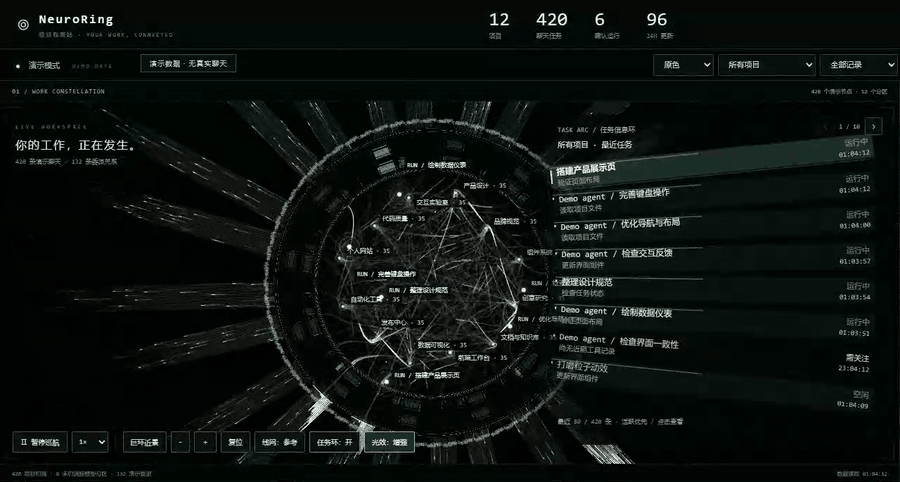
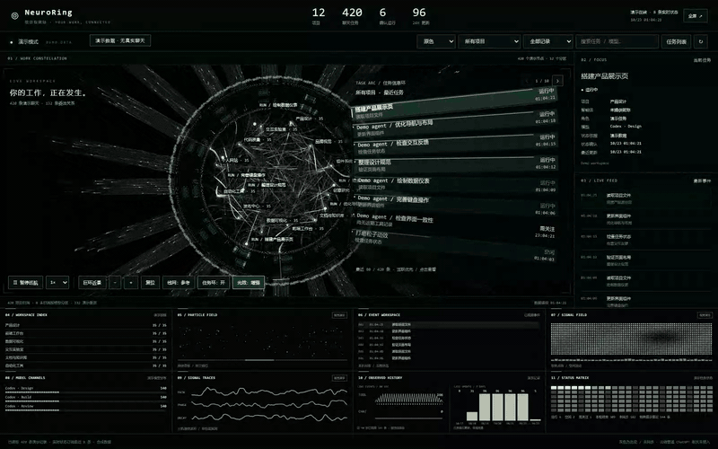

# NeuroRing

**你的工作，正在发生。**

把本机 Codex 的项目、聊天任务和委派关系，展示为一个可交互的神经环大屏。

[](https://bernie311.github.io/NeuroRing/)

**[▶ 观看 36 秒高清演示](https://bernie311.github.io/NeuroRing/)** · [下载 MP4](https://bernie311.github.io/NeuroRing/media/neuroring-showcase.mp4) · [快速开始](#快速开始) · [支持作者](#支持作者) · [商用授权](#许可与商业授权)

> 以上为实际界面录制，使用 12 个虚构项目和 420 条演示任务，不包含真实聊天。粒子与传播为视觉效果，演示中的状态也由合成数据提供。

**源码公开 · 非商业用途免费 · 商业用途须事先取得作者书面授权。**

**灵感来自 Paper Lab（Inspired by Paper Lab）。** 感谢其视觉与交互启发。

## 从全局，到一个项目

完整圆环看整体关系，项目筛选聚焦当前工作，任务列表查看细节。黑白与原色模式、巨环近景与完整圆环都可以切换。



高清短片还包含黑白到原色的切换、完整圆环与巨环近景的切换。静态细节可查看 [高清截图](docs/media/neuroring-poster.webp)。

## 功能

- 查看真实项目、未归档聊天、子任务关系、模型分布和近期事件。
- 神经环巡航、拖动转向、滚轮缩放、任务信息环和全屏展示。
- 按项目、时间和关键词筛选；支持黑白与原色模式。
- 显示已确认运行、空闲、历史结束和未同步等状态。
- 粒子、波形和信号传播属于视觉演示；RUN 标记依赖已观测到的实时状态。

## 快速开始

当前实现面向 **Windows + Python 3.11 或更新版本 + 本机 Codex 桌面版**。
Python 需加入 PATH，能够运行 `python` 和 `pythonw`。无需第三方 Python 包或前端构建工具。

```powershell
git clone https://github.com/Bernie311/NeuroRing.git
cd NeuroRing
python launch.py
```

也可以下载 ZIP，解压后双击 `启动大屏.cmd`。
启动器会自动打开浏览器。优先使用 `8791` 端口；如果该端口被系统保留或被其他程序占用，
会自动选择可用端口，不需要更改 Windows 设置。重复启动会复用已经启动的服务。
双击 `停止大屏.cmd` 可停止服务；关闭浏览器不会停止后台服务。

排查启动问题可运行 `python launch.py --no-browser`，终端会显示实际访问地址；
启动日志保存在 `launcher.log`，当前端口保存在 `.neuroring-runtime.json`。
这两个文件仅在本机使用，不进入仓库。请使用启动器打开页面，不要固定收藏某个备用端口。
曾下载旧版的用户请更新仓库或重新下载完整 ZIP，确保同时包含 `launcher_support.py`。

`catalog.json` 是可选的个人项目目录快照，不随仓库发布。
缺少该文件时会使用空目录，并继续从本机 Codex 配置与数据库发现项目和聊天。
如需维护补充目录，可复制 `catalog.example.json` 为 `catalog.json`，保留
`capturedAt` 与 `projects` 字段；每个项目使用 `projectId`、`projectKind`、`label`，可选 `path`。
请勿把包含真实项目名或本机路径的个人配置提交到公共仓库。

## 数据与兼容性

服务只监听 `127.0.0.1`。数据库以只读方式打开；程序不发起模型请求、不修改聊天任务、不注册开机启动。
它从当前用户的 `.codex` 目录读取配置、聊天索引和有限事件日志尾部，并通过 Windows 命名管道订阅桌面状态。
界面显示项目名、聊天标题、工作目录、模型、工具名称和状态，不显示完整聊天正文或工具输入输出。
订阅快照和日志可能包含正文，读取解析后仅提取所需元数据；这不等于底层从不接触正文。
展示真实数据时，截图或录屏可能暴露你的项目和聊天信息。

目前依赖 Codex 内部 `state_5.sqlite` 数据结构、全局配置和桌面状态协议（版本 11），
不是稳定的官方集成 API。Codex 更新后可能需要适配；没有兼容数据时界面会显示读取错误或未同步状态。
实时状态最多覆盖最近 8 条聊天，事件读取最多覆盖最近 120 条聊天；普通云端 ChatGPT 聊天未接入。
macOS、Linux 和其他 Codex 版本未验证；发布前检查范围见 [VALIDATION.md](VALIDATION.md)。

## 开发

- `web/`：界面、神经环、动态仪表、任务信息环与配色。
- `server.py`：本机 HTTP 服务和数据接口。
- `data_source.py`：本机项目、聊天与事件读取。
- `observer.py` / `transport.py`：Windows 桌面状态订阅与管道传输。
- `launch.py` / `stop.py` / `launcher_support.py`：自动选择端口、复用与停止本机服务。
- `tests/`：现有任务信息环测试及发布配置回归测试。

网页文件修改后刷新；Python 文件修改后重启服务。
运行检查需要 Python 和 Node.js 18 或更新版本：

```powershell
python -m unittest discover -s tests -p "test_*.py"
node --test tests/task-band.test.cjs
```

## 许可与商业授权

本项目采用自定义 [NeuroRing 非商业许可证 1.0](LICENSE)。允许在遵守许可的前提下，
为非商业目的使用、学习、复制、修改和分发；须保留版权、许可证与署名，修改版本须标明改动。

**商业使用必须事先取得作者明确的书面授权。** 商业使用包括但不限于销售或收费分发、
集成进商业产品或服务、付费托管/SaaS、客户交付，以及用于企业商业运营或商业咨询。
免费提供但服务于商业目的的使用，也需要授权。联系作者不等于获得授权。
第三方材料适用其原有许可，作者的商业授权不替代第三方许可。

这是带非商业限制的源码可用（source-available）项目，
不属于 [OSI 定义的开源软件](https://opensource.org/osd)。完整条款以 [LICENSE](LICENSE) 为准。

## 支持作者

如果 NeuroRing 对你有帮助，欢迎自愿打赏，支持后续维护与改进。
**打赏不代表获得商业使用授权；商用仍须事先取得作者的书面授权。**

### 微信

<details>
<summary>展开微信收款码</summary>


[打开收款码原图](docs/support/wechat-pay.jpg)

</details>

### USDT · Solana

币种：**USDT**。网络：**Solana（SPL）**。

```text
EHgGjMXTGgHck4zEwKpK4LqAincrRMox77ZuHijJt1a5
```

[前往打赏页面，一键复制地址](https://bernie311.github.io/NeuroRing/#support)。转账时请选择上方标明的币种与网络。

## 联系作者

- X：[@JotaroKujoX](https://x.com/JotaroKujoX)
- 微信：`D4Cexys7`

申请商用授权时，请说明使用主体、使用场景、是否修改或分发，以及部署规模。

## 灵感与致谢

**灵感来自 Paper Lab。** 此署名表达灵感来源，不表示 Paper Lab 参与开发、授权或背书。
传输层改编自作者已有的 Token Bite 本地传输实现，来源说明见 [NOTICE.md](NOTICE.md)。
NeuroRing 是独立项目，非 OpenAI 或 Codex 官方产品。
